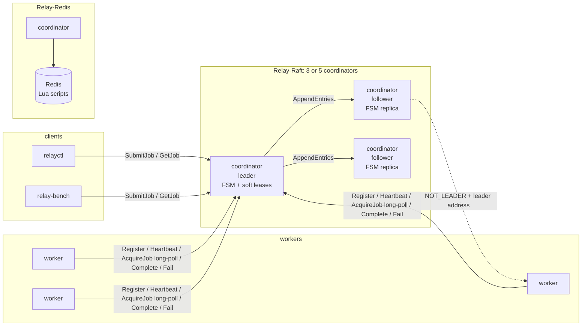

# Relay: design

Relay is a distributed task engine. Clients submit jobs, workers lease and
run them, and the system keeps every job's state transitions exactly-once
through worker crashes, stalls, network partitions and coordinator
failover. This document is the engineering RFC. Section 12 is the decision
log, written as the work happened, with the alternatives each decision
rejected. Benchmark methodology and results are in the
[README](README.md#benchmarks).

## 1. Goals and non-goals

**Goals**

- **Exactly-once state transitions under failure.** A job reaches a
  terminal state at most once, its result is written exactly once, and an
  acknowledged submission is never lost.
- **At-least-once execution**, stated honestly: handlers may run more than
  once, and the system says so.
- **No single point of failure** in the replicated (Raft) configuration.
  Losing a minority of coordinators costs at most an election.
- **Verified rather than asserted.** Every invariant above is checked by a
  seeded, reproducible chaos harness with a Jepsen-style history checker.
  The checker is itself shown to catch a deliberately injected bug.
- **Honest measurement.** Benchmarks are comparable across backends and
  are reported as measured, including the places where Relay loses.

**Non-goals**

- Exactly-once *execution*. It is impossible without cooperation from the
  side effects themselves (see §6).
- Byzantine faults, malicious workers, or authentication.
- Multi-tenant fairness, priorities, delayed or cron scheduling, and job
  dependencies.
- Horizontal write scaling. One Raft group, or one Redis, orders every
  transition.
- Garbage collection of finished jobs (see §11).

## 2. Architecture

Each coordinator serves two gRPC services, `JobService` and
`WorkerService`, plus `ClusterService` on Raft. All of them sit on one
`store.Store` interface (§12, D1) with two implementations:

| | Relay-Redis | Relay-Raft |
|---|---|---|
| State | Redis; each transition is one Lua script | in-memory FSM on every node; each mutation is a Raft log entry (raft-boltdb) |
| Coordinators | 1 (stateless; Redis is the SPOF) | 3 or 5; only the leader serves |
| Clock for leases | Redis `TIME` inside the script | the leader's monotonic clock (soft state) |
| Fencing token | per-job counter, `HINCRBY` | Raft log index of the granting entry |
| Heartbeat cost | one script call | none in the log (leader memory only) |

**Dispatch** is pull-based. A worker's `AcquireJob` long-polls. The
coordinator subscribes the poller to an in-process FIFO notifier *before*
checking the store, so a submit that lands in between still wakes it (no
lost wake-ups). Each submit wakes one poller (no thundering herd), and a
leased job wakes the next poller if more work is ready.

**Liveness** has two layers. The *failure detector* declares a worker dead
after `missed-heartbeats × heartbeat-interval` (default 3 × 1s) and
revokes all of its leases at once. The *reaper* is the backstop: it
revokes any lease whose deadline passed, for example a lease whose
acquire reply was lost, so its worker never renews it.

## 3. Data model

A **job** has an id (UUIDv7, so ids sort by creation), type, payload,
idempotency key, status, attempts, max_attempts, lease owner and token,
the token that last *reported* (`reported_token`), timestamps (created,
enqueued = eligible, leased, finished), last error, result, the submit's
W3C traceparent, and an append-only **event log** (SUBMITTED, LEASED,
RETRY, REQUEUED, RELEASED, SUCCEEDED, FAILED, DEAD). The script or command
that performs a transition appends its event atomically with it.

```mermaid
stateDiagram-v2
    [*] --> PENDING: SubmitJob
    PENDING --> LEASED: Acquire (attempts++, new token)
    LEASED --> SUCCEEDED: Complete (owner + current token)
    LEASED --> PENDING: Fail retryable, attempts < max (backoff)
    LEASED --> PENDING: lease revoked (expiry / worker death), attempts < max
    LEASED --> PENDING: Release (reply undeliverable; attempt undone)
    LEASED --> FAILED: Fail non-retryable
    LEASED --> DEAD: attempts exhausted
```

A **worker** has an id (`w-<hostname>-<random>`), hostname, concurrency,
state (ALIVE/DEAD), a registration time, the leases it holds, and a last
heartbeat (Redis: a sorted set; Raft: leader soft state). A worker that
was declared dead must re-register under a new id. Every call made with
its old id is rejected with `FAILED_PRECONDITION`.

**Redis layout:** `relay:ready` and `relay:leases` (ZSETs by eligible time
and lease deadline), `relay:job:{id}` (HASH) plus `:events` (LIST),
`relay:idem:{key}` (`SET NX`), `relay:workers` (ZSET by heartbeat),
`relay:worker:{id}` plus `:jobs`, and `relay:dead`.

**Raft FSM:** `jobs` map, a ready B-tree ordered by (eligible, id), an
idempotency map, workers, per-worker held-lease sets, the leased set, and
node id → gRPC address. Only `jobs`, `idem`, `workers` and `nodeAddrs` are
snapshotted. The rest is derived on restore.

## 4. Leases and fencing

A lease is (job, owner, token). Every holder report (Complete, Fail)
carries owner and token, and is applied only if the job is **LEASED to
that owner with that token**. The check and the write are one atomic step:
the same Lua script in Redis, the same FSM command in Raft.

- A lease is revoked (worker death, expiry) or replaced (re-acquire) under
  a **strictly larger token**. The old holder's late report is therefore
  rejected (`ABORTED`) without touching the result, owner or timestamps.
- A **retried** report on the same lease (lost reply) finds
  `reported_token == token` and returns ALREADY. It is not applied twice.
- Heartbeats renew **only the leases the worker names**, so a lease whose
  acquire reply never arrived cannot be kept alive by an unrelated
  heartbeat.
- Tokens: in Redis, a per-job counter that is never reset. In Raft, the
  log index of the acquire entry, which is unique and increasing across
  terms by construction (§12, D6).

Fencing is what makes failure detection a *liveness* concern rather than a
*safety* one. Detection can be wrong in either direction: it can declare a
slow worker dead, or keep a dead one alive for a while. Neither can
produce a second terminal transition.

## 5. Delivery semantics

**Execution is at-least-once.** A coordinator cannot tell a dead worker
from a slow or partitioned one. It reassigns the job, and the original
holder may still finish running it. Handlers must therefore be idempotent
or tolerate re-runs. The fault benchmark counts these duplicate
executions for every backend.

**State transitions are exactly-once.** Fencing (§4) guarantees at most
one terminal transition and a result written exactly once. The chaos
checker verifies both from the server's event log *and* from the clients'
view.

**Submission is idempotent.** A submit with a key that has been seen
before returns the original job id (`duplicate=true`). On Redis, `SET NX`
and job creation run in one script. On Raft, the idempotency map is part
of the FSM. Retrying a submit through timeouts, restarts and failovers is
therefore safe, and every client in this repo retries that way.

## 6. Why not exactly-once execution

Running a job exactly once needs the side effect and the "done" mark to
commit atomically together, or the side effect to be idempotent. A worker
that crashes after its side effect but before reporting is
indistinguishable from one that crashed before. The scheduler would have
to either re-run the job (at-least-once) or risk never running it
(at-most-once). Relay chooses not losing work. It makes the *bookkeeping*
exactly-once, which is the part the scheduler controls.

## 7. Raft integration and the soft-state lease argument

The details are in §12, D6. In short:

1. Every mutation is a command. The leader stamps time, ids and jitter
   into it, so `Apply` is deterministic: it reads no clocks, uses no
   randomness, and iterates maps in sorted order.
2. Lease **deadlines and heartbeats are not replicated**. The FSM records
   owner and token. Deadlines live in the leader's memory, on its
   monotonic clock. Renewal writes nothing to the log.
3. The reaper proposes `ExpireLease(job, token)`. The FSM applies it only
   if `token` is still current.
4. A new leader calls `Barrier()`, resets every lease deadline to
   `now + lease_duration` and every heartbeat to `now`, and only then
   serves. Every worker gets a full grace period.

**Safety argument.** Resetting or losing soft state only ever *extends*
leases. What prevents a double completion is the token check in step 3
and in every report, both of which go through the log. A lease that
outlives its holder delays recovery by at most one lease period plus an
election. It never allows two holders to both succeed, because the second
grant has a larger token and the first holder's report then fails the
check. The trade is bounded extra recovery latency in exchange for zero
log writes per heartbeat, and the chaos sweep exercises it: leader kills,
partitions, and full-cluster restarts while leases are live.

**Leader handling.**
- Followers answer NOT_LEADER with the leader's id and gRPC address, and
  every client follows it (`rpc.DialCluster`).
- Fresh reads call `VerifyLeader()`.
- Losing leadership wakes every pending long-poll, which then returns
  NOT_LEADER.
- A minority-side old leader can neither commit writes nor serve reads.
  `TestMinorityLeaderStepsDown` checks this, and so does the chaos fault
  `partition-leader`, which cuts the leader from its peers while clients
  can still reach it.

## 8. Failure modes

| Fault | Behavior | Why it is safe |
|---|---|---|
| Worker crashes (`docker kill`) | Detected after 3 missed heartbeats; every lease it held is revoked and requeued at once | Revocation and requeue are one atomic transition; the next lease has a larger token |
| Worker stalls or is partitioned, then returns | Declared dead, job reassigned; its heartbeat gets `FAILED_PRECONDITION` and it re-registers; its late report gets `ABORTED` | Fencing: the stale token fails the check, so nothing is written |
| Lease expires while the worker is alive | Reaper requeues the job | Same as above; the worker's report is fenced out |
| Acquire reply lost | The lease is released at once if the coordinator saw the cancel, otherwise it is never renewed and expires | Heartbeats renew only named leases |
| Report reply lost; worker retries | ALREADY; not re-applied | `reported_token` |
| Submit reply lost; client retries | The same job id is returned | Idempotency key, atomic with creation |
| Coordinator crash (Redis) | Clients get UNAVAILABLE and retry; liveness waits out a startup grace | All state is in Redis |
| Raft follower crash / partition | Nothing visible; it catches up from the log or a snapshot when it returns | Quorum still commits |
| Raft leader crash | Election (≈1–3s with defaults); clients follow NOT_LEADER to the new leader; new leader resets soft leases | Committed entries survive (Leader Completeness); tokens are log indices |
| Raft leader partitioned to the minority | It steps down after its lease timeout; its writes cannot commit, its reads fail `VerifyLeader`; the majority elects a new leader | Quorum intersection |
| Whole Raft cluster restarts | State is restored from snapshot plus log; serving resumes with a fresh grace period | Durable log (bbolt), deterministic replay |
| Clock skew between nodes | No effect on safety; Raft deadlines use the leader's monotonic clock, Redis uses Redis `TIME` | Tokens, not times, decide every transition |
| Redis crash (Relay-Redis) | **Not handled**: Redis is the single point of failure; AOF `everysec` can lose about 1s of acknowledged transitions | This is the explicit scope boundary that Relay-Raft removes |

## 9. Verification

| Layer | What it checks |
|---|---|
| Unit tests | every Lua script and every FSM command, with `-race` |
| Store conformance suite (`internal/store/storetest`) | 14 behavioral tests run unchanged against Redis, a 1-node Raft cluster and a 3-node Raft cluster |
| Raft tests | byte-identical replicas and log replay; snapshot install after compaction; full-cluster restart; failover with fencing; minority leader; membership changes |
| Integration (`test/integration`) | real containers: worker kill and pause, coordinator restart, idempotency, retries, Raft leader kill, membership via relayctl |
| Chaos (`cmd/relay-chaos`, `internal/check`) | seeded faults against real clusters; Jepsen-style histories; invariants plus per-job linearizability (porcupine) |
| Deliberate bug (`relay_nofence`) | the checker flags fencing violations and non-linearizable histories on both backends |

**Chaos sweep.** On the Raft backend, the sweep ran relay-chaos for 5
minutes per seed with every fault kind enabled: worker kill, pause and
partition; coordinator kill, pause, restart, client isolation and backend
partition; leader kill, pause and partition (minority side); full-cluster
restart; and Toxiproxy latency. Results: all 20 seeds pass (1–20), with zero invariant violations. The
binary was commit `373990c`, run as image `relay:sweep-m3`.

| Totals | |
|---|---|
| jobs acknowledged and checked | 158,273 |
| recorded operations | 1,145,068 (38,247 indeterminate) |
| faults injected | 1,100: 59 leader kills, 66 leader partitions, 58 leader pauses, 52 full-cluster restarts, 405 other coordinator faults, 360 worker faults, 100 latency windows |
| leader elections (including restarts) | 379 |
| stale reports rejected by fencing | 2,305 |
| NOT_LEADER redirects followed | 65,458 |
| fencing checks performed by the checker | 426,166 |

| seed | jobs | ops | faults | elections | stale rejected | violations |
|---|---|---|---|---|---|---|
| 1 | 8,777 | 62,272 | 60 | 18 | 97 | 0 |
| 2 | 7,538 | 57,243 | 52 | 21 | 155 | 0 |
| 3 | 6,819 | 51,194 | 56 | 22 | 81 | 0 |
| 4 | 8,892 | 66,034 | 56 | 14 | 121 | 0 |
| 5 | 7,723 | 55,565 | 49 | 21 | 116 | 0 |
| 6 | 7,468 | 52,842 | 55 | 25 | 148 | 0 |
| 7 | 7,707 | 61,568 | 60 | 18 | 123 | 0 |
| 8 | 7,066 | 52,903 | 50 | 22 | 228 | 0 |
| 9 | 8,093 | 58,146 | 59 | 18 | 109 | 0 |
| 10 | 8,190 | 59,411 | 54 | 21 | 92 | 0 |
| 11 | 7,902 | 57,135 | 61 | 21 | 78 | 0 |
| 12 | 8,059 | 56,977 | 59 | 18 | 71 | 0 |
| 13 | 6,969 | 50,915 | 49 | 21 | 144 | 0 |
| 14 | 8,502 | 63,734 | 53 | 18 | 110 | 0 |
| 15 | 7,420 | 52,653 | 52 | 18 | 125 | 0 |
| 16 | 7,153 | 51,027 | 59 | 18 | 149 | 0 |
| 17 | 7,796 | 55,265 | 56 | 18 | 107 | 0 |
| 18 | 8,987 | 61,652 | 52 | 16 | 53 | 0 |
| 19 | 8,171 | 56,548 | 57 | 16 | 115 | 0 |
| 20 | 9,041 | 61,984 | 51 | 15 | 83 | 0 |

Raw per-seed numbers are in `bench/results/chaos-sweep-raft.json`.
Reproduce a seed with `make chaos SEED=n`.

## 10. Alternatives considered

**Redis Redlock for lease ownership.** Redlock acquires a lock on a
majority of independent Redis nodes and relies on bounded clock drift and
on the holder finishing before the lock's TTL. It gives the lock holder no
fencing token, so a client that pauses (GC, `docker pause`) past its TTL
believes it still holds the lock. The *store* cannot reject its writes,
because it has nothing to compare. That is exactly the zombie the chaos
harness creates hundreds of times per run. Relay needs a monotonic token
checked at the store, which Redlock does not provide. asynq, measured in
the benchmarks, has the same shape: the worker checks its lease against
*its own clock* before writing, and Redis does not check a token.

**etcd as the replicated store.** etcd would provide linearizable storage,
leases and revision numbers (usable as fencing tokens) out of the box.
Relay-on-etcd would be a smaller codebase. It was rejected because every
transition would become a multi-key etcd transaction over the network
instead of a local FSM update, and etcd leases are per-key TTLs that cost
a write to renew. The soft-state lease design (§7), which keeps heartbeats
out of the log entirely, would not be possible, and the job's queue and
indexes would have to be maintained through watches. The deeper point was
also to own the state machine and show its determinism and failover
argument end to end.

**Writing Raft from scratch.** Rejected (§12, D6). The value of this
project is the scheduler's correctness under failure, and a home-grown
consensus layer would put the riskiest code in the least-tested place.
`hashicorp/raft` is used by Consul, Nomad and Vault.

**Push vs. pull dispatch.** With *push*, the coordinator picks a worker
and sends it the job. That needs per-worker capacity tracking, and any
error in that tracking turns into overload or idling, plus a delivery
protocol on top. With *pull* (long-poll), a worker asks only when it has a
free slot, so capacity is implicit and backpressure is free. The cost is
the wake-up path, which the FIFO notifier makes cheap: one wake per job,
no lost wake-ups. Latency stays sub-millisecond on Redis (see benchmarks).
On Raft, an acquire costs a log commit, which push would also pay.

**Replicating heartbeats** (lease deadlines in the FSM). This is simpler
to reason about, but costs a log write per worker heartbeat (or per
lease), which takes write bandwidth from real transitions and adds no
safety, since fencing carries safety (§7).

**Per-job counters as Raft tokens.** They would work too, being
incremented in the FSM. Log indices make the token monotonic *globally*
and free, and they make "token = the entry that granted this lease" a
debuggable fact.

## 11. Known limitations

- **Redis is a single point of failure** for Relay-Redis, and AOF
  `everysec` can lose about 1s of acknowledged transitions on a Redis
  crash. Use Relay-Raft when that matters.
- **Raft write throughput is bounded by one leader's log**, and every
  acquire is a log entry (fsync per batch). The benchmarks show the
  resulting gap against Redis-based systems.
- **No garbage collection of finished jobs or idempotency keys.** Both
  stores grow without bound, and the Raft snapshot (a full JSON
  serialization on the FSM goroutine) grows with them. Production would
  need TTLs and compaction of terminal jobs.
- **Snapshot cost is O(state) and blocks Apply** while it serializes. A
  persistent data structure or copy-on-write maps would remove that.
- **Lease revocation can be slightly early on Raft.** A heartbeat that
  races an `ExpireLease` already in flight cannot save that lease (§12,
  D6). This costs one needless reassignment, never correctness.
- **Dispatch latency across a leader change mixes two clocks.** The
  internal metric's `storeNow - eligibleAt` term can span two leaders'
  wall clocks. It is bounded by the request-arrival term and does not
  affect state.
- **Scripts build keys dynamically**, so Relay-Redis is not Redis Cluster
  safe.
- **Commands are JSON**, roughly 2× larger than protobuf. That is simple
  and deterministic, but not compact.

## 12. Decision log

### D1. One `Store` interface covering every state transition (M1)

**Decision.** `internal/store` defines `Store`, and the coordinator depends
only on it. Its methods are Submit, RegisterWorker, Acquire, Renew,
Complete, Fail, Release, ReapExpired, ExpireWorkers, Get, ListWorkers and
QueueDepth. Backends live in `internal/store/redis` (package `redisstore`)
and `internal/store/raft` (package `raftstore`).

**Liveness is inside the interface.** Renew, ReapExpired and ExpireWorkers
are store methods, not coordinator logic. Redis keeps heartbeats and lease
deadlines in Redis. Raft keeps them as soft state on the leader (D-raft
below). The coordinator's liveness loop calls the same two methods either
way, so lease bookkeeping can live where each backend needs it.

**Alternatives.**
- *A narrower key-value interface (CAS on job records) with transition logic
  in the coordinator.* Rejected. On Redis, each transition would become a
  read-modify-write over several round trips. The atomicity that one Lua
  script gives today would have to be rebuilt with WATCH/MULTI.
- *Separate `LeaseManager` and `JobStore` interfaces.* Rejected. A worker's
  death and the requeue of its leases must be atomic: in Redis one script
  does both, and in Raft one FSM command does both. Splitting the
  interfaces would separate those two writes.

**NOT_LEADER.** A replicated store returns `*store.NotLeaderError`. The
coordinator maps it to gRPC `UNAVAILABLE` with an `ErrorInfo{reason:
NOT_LEADER, metadata: leader_id, leader_addr}` detail. It is not
`FAILED_PRECONDITION`, because workers already treat that code as "you
were declared dead, re-register". The detail means *the call did not
execute*, so the client library may redirect it blindly. A plain
`UNAVAILABLE` means the outcome is unknown.

**Conformance.** `internal/store/storetest` uses only the interface. It
checks that fencing tokens increase and never checks their exact values,
because Redis tokens count per job and Raft tokens are log indices. It
checks structure through `QueueDepth` and `ListWorkers` rather than
backend keys. Redis-only layout tests stay in `store/redis`.

### D2. Chaos histories: one clock, unbuffered writes, three outcome types (M2)

**Decision.** Every client-visible RPC is recorded by a gRPC client
interceptor (`internal/history`) as an `invoke` record and then an `ok`,
`fail` or `info` record, Jepsen style. Records are JSONL, written with
one `write(2)` each to an unbuffered file. A `docker kill` therefore loses
nothing already recorded, and an invoke with no completion is read back as
indeterminate.

- `ok` covers success and *definite* answers about job state (ABORTED for
  a stale lease, NOT_FOUND, FAILED_PRECONDITION for a dead worker). The op
  ran, and its code is an observation that the model has to explain.
- `fail` means the op certainly did not execute: NOT_LEADER, or an invalid
  argument.
- `info` covers everything else (UNAVAILABLE, deadline, cancel). The op
  may or may not have applied.

**One clock.** Porcupine orders ops by real time, so every recorded
process must read the same clock. Workers and the load generator all run
as containers in the same Docker VM and share its `CLOCK_REALTIME`. The
host only injects faults, and its fault timeline is never used in checks.
*Rejected:* running the load generator on the host. macOS and the Linux
VM can drift by milliseconds, which is enough to report a false
linearizability violation.

### D3. The checker: invariants plus a nondeterministic per-job model (M2)

The checker runs after quiescing. It combines the history with every
job's final state and its server-side event log, read through the normal
recorded client. Every invariant is checked independently from both the
client's and the server's point of view, where both views exist:

| Invariant | Client view | Server view |
|---|---|---|
| no lost acks | every acked id is readable | — |
| all jobs terminal | — | status is terminal after quiescing |
| terminal at most once | ≤1 lease had its terminal report accepted | ≤1 terminal event, and it is the last event |
| fencing | no accepted report was *sent* after a newer token had been handed out | every holder transition carries the token and worker of the latest LEASED event, with no REQUEUED/RELEASED in between |
| idempotency | all acks of a key name one job; ≤1 reported "created" | the job stores that key; no other job carries it |
| attempts | — | attempts ≤ max; DEAD ⇒ attempts = max; LEASED − RELEASED = attempts |

**Linearizability.** Porcupine checks each job's history, partitioned by
job id, against a `NondeterministicModel`. Clients never observe some
transitions: lease expiry, worker death, a lease whose acquire reply was
lost, and the coordinator releasing such a lease. Before each observed op
the model takes the closure over those *internal* transitions. A lease
nobody observed is tracked as `Hidden`: its token is known only to be
greater than the last observed one. The model therefore needs tokens to
increase, never to increase by exactly one, which is what lets the same
checker accept Raft log-index tokens. Heartbeat responses are *not* in
the model. They are advisory, because the authority on a lease is the
fencing token and not the renewal reply.

**Freeze before the final read.** The first deliberate-bug runs
overloaded the cluster, so quiescing timed out with jobs still running,
and a worker completed a job *after* the load generator's "final" read.
The checker correctly reported a contradiction, but the bug was in the
harness. The fix is a hand-off: once the load generator is done
quiescing it writes `quiesced`, the orchestrator SIGKILLs every worker
and writes `frozen`, and only then does the load take the final
snapshot. After that no recorded op can follow the snapshot. The
alternative, comparing the final state only against ops that finished
before each job's final read, was rejected because it silently shrinks
what gets checked.

### D4. Proving the checker catches bugs (M2)

**Decision.** The `relay_nofence` build tag sets `store.FencingEnabled =
false`. In Redis, `complete.lua` and `fail.lua` then accept any report on
a LEASED job, whoever holds the lease. The tag is only ever compiled into
the separate `relay:nofence` image. A plain runtime flag was rejected,
because a production binary should not be able to switch fencing off.

**Workload matters.** In the first nofence run, a heavy load (40
submits/s of 2–6s jobs on 20 slots) produced 19 zombie reports and
*none* were accepted, even with fencing disabled. Requeued jobs waited
minutes in the backlog, so each zombie report arrived while its job was
PENDING, and Lua rejects those even without the token check. The test
therefore uses 3 submits/s of 3–6s jobs, so a requeued job is re-leased
at once and the zombie reports while the new lease is live. With that
workload the checker flags 14 fencing violations and 9 non-linearizable
jobs, and every other invariant stays clean. That makes it a precise
detector, not a noisy one. `test/chaos/nofence_test.go` runs this
automatically.

### D5. History timestamps use CLOCK_MONOTONIC (M2, found in M3)

**Finding.** A 5-minute Redis chaos run (seed 2) reported one job as
non-linearizable. Its history was trivially linearizable (submit →
acquire → complete → reads that all said SUCCEEDED), but one read
*returned 3.4ms before it was invoked*. The Docker VM's wall clock had
stepped backwards, most likely a time-sync correction against the host.
Porcupine cannot place an op whose interval is inverted, so it rejected
a correct history.

**Fix.** Records are ordered by `CLOCK_MONOTONIC`. On Linux it is one
system-wide clock, so it is comparable across every container on the VM
kernel, and it never steps backwards. Records keep the wall clock in a
separate field, for correlating with Docker events in M5. The reader now
*rejects* any op whose completion precedes its invocation, so a clock
problem fails loudly as a harness error and never looks like a Relay
bug. Re-checking the saved run produces exactly that error, naming the
single inverted op.

### D6. Raft integration (M3)

*Verification:* the 20-seed sweep in §9, with zero violations.

**Library.** `hashicorp/raft` with `raft-boltdb/v2` (bbolt) for the log
and stable store, and file snapshots. Writing Raft from scratch was
rejected: the risk sits in exactly the corner cases (log matching after
leader changes, joint configuration changes, snapshot install) that a
battle-tested library already handles. Relay's value is in what it
builds on top.

**Replicated FSM.** Every mutation of job or worker state is one
command: submit, register, acquire, complete, fail, release,
expire_leases, expire_workers, set_node_addr. The FSM ports the Lua
scripts transition for transition, including the exact backoff
arithmetic, and the same conformance suite checks both backends.
Determinism rules:
- `Apply` never reads the clock or a random source. The leader stamps
  `now`, ids, and the backoff jitter into the command when it proposes.
- `Apply` iterates maps only in sorted order. Worker death revokes leases
  in job-id order, so event logs are identical on every replica.
- Backoff base and max travel in each command, so nodes with different
  flags cannot diverge.
- `TestReplicasAreIdentical` checks the result: all replicas, and a fresh
  FSM replaying the leader's log, serialize to the same bytes.

Commands are JSON, not protobuf as first planned. Go's `encoding/json`
output for structs and maps is deterministic, which is all the FSM
needs, and JSON avoids a second codegen path. Its cost (base64 payloads,
roughly 2× larger entries) shows up in the M5 numbers.

**Fencing token = log index of the granting entry.** Raft log indices
are unique and strictly increasing across the whole log, including
across terms and leader changes. A new leader's entries always come
after every committed entry of earlier terms (Leader Completeness), and
an uncommitted entry that gets overwritten never reached `Apply`, so its
index was never handed out as a token. A lease granted later therefore
always has a larger token, without a per-job counter. Two leases can
never share a token, because each acquire is its own entry.

**Soft-state leases.** The FSM stores a lease's owner and token, never
its deadline. Deadlines (`leases`) and worker heartbeats (`beats`) live
only in the leader's memory, on its monotonic clock:
- A heartbeat (`Renew`) checks ownership against the FSM and moves the
  deadline. It costs no log write. With N workers heartbeating every
  500ms, this keeps 2N entries per second out of the log.
- The reaper proposes `expire_leases(job, token)`. The FSM revokes the
  lease only if `token` is still current, so a proposal that raced a
  completion or a newer lease does nothing.
- On election the new leader calls `Barrier()`, so its FSM holds every
  committed entry. It then sets every lease deadline to now + lease and
  every live worker's heartbeat to now, and only then serves.

*Why this is safe.* Losing or resetting soft state can only make a lease
last *longer* than it would have. What stops a double completion is
fencing, not the deadline. A worker whose lease expired late still
cannot complete once the job has been re-leased, because its token is no
longer current. A worker that resumes after a failover keeps its lease
and can complete, which is correct, since nobody else holds it. The
worst case is delayed recovery: up to one extra lease period plus one
election timeout before a dead worker's jobs are requeued.

*Worker death is replicated, heartbeats are not.* `expire_workers` is a
command, so "a dead worker must re-register" holds on every leader.
Re-registration is rare and worth a log entry. Heartbeat timestamps are
the high-rate part and stay soft.

*A lease can be revoked slightly early.* A heartbeat can land after the
reaper has decided to expire that lease but before the command commits.
Redis avoids this because its heartbeat and reap scripts are atomic with
each other. Here the cost is one unneeded reassignment, never a
correctness problem.

**Leader-only serving.**
- Writes and `AcquireJob` go to the leader. A follower returns
  `NotLeaderError` with the leader's id and its gRPC address, which is
  replicated in the FSM by `set_node_addr`.
- `Get` and `ListWorkers` call `VerifyLeader()` first. A deposed leader
  that has not noticed yet cannot serve a stale read.
  `TestMinorityLeaderStepsDown` checks this: an isolated old leader
  refuses both reads and writes.
- When leadership is lost, the coordinator wakes every pending long-poll.
  Each one retries the store, gets NOT_LEADER, and returns it.
  `TestLeadershipLossFailsPendingLongPolls` checks this happens within 1s
  for five blocked pollers.
- An empty `AcquireJob` costs no log entry. The leader checks its own FSM
  first, which holds every acknowledged submit and requeue.
- A duplicate idempotency key is answered from the FSM. A committed entry
  is never undone, so even a deposed leader answers that correctly.

**Proposal outcomes.** Apply returns `raft.ErrNotLeader` before anything
is appended, so it maps to NOT_LEADER, which is safe to redirect.
`ErrLeadershipLost` and timeouts *after* proposing have unknown outcomes.
They map to plain UNAVAILABLE, the client library does not replay them,
and the caller's own retry logic runs instead (idempotency keys for
submits, ALREADY for reports).

**Client library.** `rpc.DialCluster` keeps one connection per endpoint
and routes each call to the believed leader:
- NOT_LEADER → follow the hint (by node id, so it works through
  Toxiproxy or published host ports), otherwise try the next node; retry
  with jittered backoff until the call's deadline.
- Any other UNAVAILABLE or deadline → return the error unretried, but
  send the next call to a different node.
- `WaitForReady(false)` → a dead node fails fast instead of absorbing a
  30s long-poll deadline.

Workers, relayctl, relay-bench and relay-chaos all use it.

**Membership.** Every node can bootstrap from an identical peer list
(`--bootstrap --peers`); hashicorp/raft treats that as idempotent, and a
node with existing state skips it. Nodes are added and removed through
`ClusterService.AddVoter/RemoveServer` (`relayctl cluster add|remove`).
A new node catches up by snapshot install when the log has been
compacted past it (`TestAddAndRemoveVoter`).

**Snapshots.** `Snapshot()` serializes the whole FSM to JSON on the FSM
goroutine, which holds up Apply for O(state). It is simple and correct.
Its cost grows because terminal jobs are never deleted (see limitations).
`Restore` rebuilds the derived indexes (ready queue, leased and held
sets) from the jobs. `TestSnapshotRestoreAndCatchUp` compacts the log
past a stopped follower and checks that it installs the snapshot and
converges. `TestFullClusterRestart` restarts all three nodes from
snapshot plus log.

### D7. Observability (M4)

**One trace per job across an asynchronous queue.** otelgrpc propagates
trace context in gRPC metadata, which covers every RPC hop. The gap from
"enqueued" to "picked up by a worker" is not an RPC, so the submit's W3C
`traceparent` is stored with the job: a `trace_parent` hash field in
Redis, a command field in Raft. When the job is assigned, the coordinator
creates a `relay.dispatch` span *in the job's trace*. The span is backdated
to the acquire call, carries the measured dispatch latency and queue wait
as attributes, and links to the worker's AcquireJob RPC span (a different
trace). The dispatch span's traceparent goes back in the AcquireJob
response, so the worker's `relay.execute` span is its child, and the
Complete/Fail RPC is a child of the execution. A retried job therefore
shows each attempt as its own dispatch → execute → report branch under one
enqueue. `TestJobTraceSpansSubmitToComplete` asserts the whole parent
chain in-process. *Rejected:* one trace per AcquireJob. That is easier,
but it loses the ability to see a job's whole life, including retries
and reassignments, in one place.

**Prometheus.** `/metrics` serves the Prometheus text format, and the
HdrHistogram JSON snapshot that relay-bench reads moved to
`/metrics.json`. The definitions are unchanged. Counters read the
existing atomics at scrape time (`CounterFunc`) instead of being counted
twice. The latency histograms feed Prometheus and HdrHistogram from the
same `Record` call. Prometheus buckets are coarse, so the benchmark
numbers keep coming from HdrHistogram. `relay_queue_depth` and
`relay_leases_active` are gauges read from the store at scrape time. Every
Raft node reports its own replica's depth, so the dashboard shows the
max.

**Startup bug found by running it.** With tracing enabled, the
coordinator exited at startup with "conflicting Schema URL". The SDK's
default resource and the pinned semconv version disagreed. Unit tests
never set an endpoint, so they missed it. The fix is a schemaless
service-name resource, and `TestSetupWithEndpoint` now exercises the real
exporter path.
