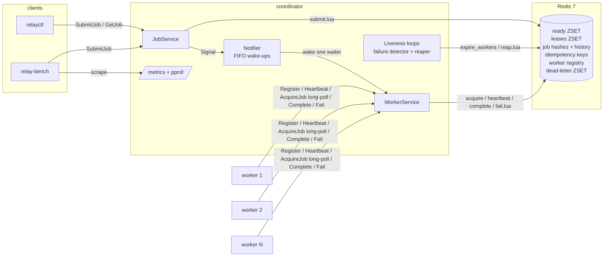
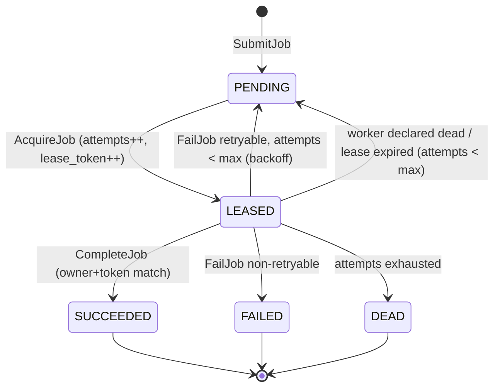
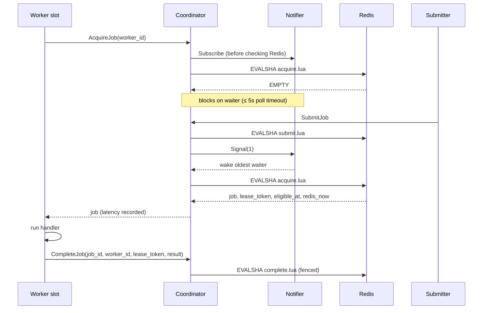

# Relay

Relay is a distributed task execution engine written in Go. Clients submit jobs to a **coordinator**. A pool of **workers** long-polls for those jobs, runs them, and reports the results. The system stays correct when workers crash, stall, or come back late. Redis is the only stateful dependency, and every state transition is a single atomic Lua script.

The project puts correctness under failure and honest measurement ahead of feature count. Every failure mode listed below has an automated test that kills, pauses, or restarts real containers and then checks the final job states.

- [Architecture](#architecture)
- [Delivery semantics](#delivery-semantics)
- [Failure modes](#failure-modes)
- [Running it](#running-it)
- [Testing](#testing)
- [Benchmark](#benchmark)
- [Design notes and limits](#design-notes-and-limits)

## Architecture



There are three binaries plus a benchmark tool:

| Binary | Role |
|---|---|
| `coordinator` | gRPC server (`JobService` and `WorkerService`), the long-poll dispatcher, the failure detector and the lease reaper. It keeps no durable state in memory, so a restart loses nothing. |
| `worker` | Registers, heartbeats, and runs `--concurrency` acquire→run→report loops. It ships with three handlers: `noop`, `sleep` and `fail-n-times`. On SIGTERM it stops acquiring and drains in-flight jobs. |
| `relayctl` | CLI with four commands: `submit [--wait]`, `get <id>` (which includes the job's transition history), `workers` and `health`. |
| `relay-bench` | Starts a compose cluster, drives load, scrapes coordinator metrics, and writes `bench/results/<timestamp>.json`. |

### Job lifecycle



### Dispatch path



`AcquireJob` subscribes to the notifier **before** it checks Redis. That removes the lost-wake-up race: a submit that lands between the check and the wait still finds the waiter in the queue. Each submit wakes one waiter, not all of them, so there is no thundering herd. When the acquire script leases a job, it also reports whether another job is already eligible, and if so the coordinator passes the wake-up on to the next waiter. Retries that become eligible in the future arm a single timer, set for the earliest deadline.

### Redis layout

| Key | Type | Purpose |
|---|---|---|
| `relay:ready` | ZSET | job id scored by eligible-at (ms). Backoff retries are scored in the future. |
| `relay:leases` | ZSET | job id scored by lease expiry (ms); the reaper scans it |
| `relay:job:{id}` | HASH | id, type, payload, idempotency_key, status, attempts, max_attempts, lease_owner, lease_expires_at, lease_token, created_at, enqueued_at, leased_at, finished_at, last_error, result |
| `relay:job:{id}:events` | LIST | transition history, appended by the script that made each transition |
| `relay:idem:{key}` | STRING | idempotency key → job id (`SET NX`) |
| `relay:workers` | ZSET | live worker id scored by last heartbeat |
| `relay:worker:{id}` / `:jobs` | HASH / SET | worker metadata, plus the leases it holds (used for immediate requeue on death) |
| `relay:dead` | ZSET | dead-letter set |

The scripts are embedded with `go:embed`, preloaded with `SCRIPT LOAD`, and run with `EVALSHA`, falling back to `EVAL` after a Redis restart. Every timestamp and every piece of lease math comes from `redis.call('TIME')`, so a coordinator with a skewed clock cannot break a lease.

## Delivery semantics

Relay gives **at-least-once execution** and **exactly-once state transitions**. These are two different guarantees.

**Execution is at-least-once.** A job can run more than once. Suppose a worker crashes, stalls or is partitioned partway through a job. The coordinator cannot tell "dead" from "slow", so it revokes the lease and gives the job to another worker. The first worker may in fact still be running it. Handlers therefore have to be idempotent, or at least tolerate being re-run. That cost is unavoidable: a system that never re-runs work has to accept losing jobs instead.

**State transitions are exactly-once.** A job reaches a terminal state exactly once, and its result is written exactly once. Fencing tokens enforce this:

1. Each lease gets a `lease_token` from a per-job counter that increases monotonically and is never reset.
2. `CompleteJob` and `FailJob` carry `(worker_id, lease_token)`. The Lua script applies them only if the job is still `LEASED` to that owner with that token. The check and the write happen in the same atomic script.
3. Once a lease is revoked and the job is re-leased, the old holder's token no longer matches. Its late result is rejected with gRPC `ABORTED`, and the worker logs `stale lease, dropping result` and moves on.
4. A *retried* report on the same lease, for example after a network blip, returns `already_completed` instead of being applied twice.

Every transition appends to the job's history in the same script that performs it. The integration tests use that history to assert that each job has exactly one terminal event.

**Submission is idempotent.** `SubmitJob` with an idempotency key that has already been seen returns the original job id (`duplicate=true`) and never creates a second job. The `SET NX` and the job creation happen in the same script. Clients can therefore retry a submit safely through timeouts and coordinator restarts.

## Failure modes

| Failure | What happens | Why it is safe | Test |
|---|---|---|---|
| **Worker crashes** (`docker kill`) | The worker stops heartbeating. After `missed-heartbeats × heartbeat-interval` (default 3 × 1s), the failure detector declares it dead and requeues every job it held at once (`attempts` was already incremented at lease time). Another worker picks the job up. | Requeueing is atomic with declaring the worker dead. A dead worker cannot acquire or renew anything until it re-registers under a new id. | `TestWorkerKilledMidJob` |
| **Worker stalls and comes back** (`docker pause`, GC pause, partition) | It is declared dead and its job is reassigned under a higher lease token. When it resumes, its heartbeat is rejected (`FAILED_PRECONDITION`) and it re-registers. Its late `CompleteJob` is rejected with `ABORTED`. | Fencing: the stale token doesn't match, so the stored result, owner and `finished_at` stay untouched. | `TestPausedWorkerIsFencedOut`, `TestZombieResultRejected` |
| **Lease expires without the worker being declared dead** | The reaper, which runs every 500ms, finds the lease in `relay:leases` and requeues the job. | This is the backstop for any lease the detector doesn't cover. Revocation and requeue happen in one script. | `TestExpiredLeaseReapedWhileWorkerAlive`, `TestReapExpiredLeases` |
| **AcquireJob response lost** (worker cancels mid-call or the connection drops) | If the coordinator sees the cancel, it releases the lease immediately and undoes the attempt. If it doesn't, the worker never learns about the lease and never reports it in a heartbeat. Heartbeats renew **only leases the worker reports holding**, so this lease expires and gets reaped. | A lease nobody is running can't be kept alive forever by an unrelated heartbeat. | `TestReleaseUndoesAttempt`, `TestHeartbeatRenewsOnlyReportedLeases` |
| **Coordinator crashes and restarts** | All state is in Redis. Workers' long-polls and reports fail with `UNAVAILABLE` and retry with backoff. gRPC reconnects within about 1s of the restart. Detection and reaping wait out a startup grace period, so workers aren't declared dead because their heartbeat timestamps went stale during the outage. | No transition depends on in-process state. Grace affects efficiency only, never safety, because fencing still guards every result. | `TestCoordinatorRestart` |
| **Client retries a submit** | The same idempotency key returns the same job id. | `SET NX` and job creation are atomic. | `TestIdempotentSubmissions`, `TestSubmitIdempotent` |
| **Worker retries a report** | The same token returns `already_completed`, and the result is not rewritten. | `reported_token` records which lease reported. | `TestCompleteFencing` |
| **Handler keeps failing** | A retryable error is retried with exponential backoff and equal jitter (`delay ∈ [d/2, d]`, `d = base·2^(attempt−1)`, capped). Once `max_attempts` is used up the job goes to `DEAD` and into `relay:dead`. A non-retryable error goes straight to `FAILED`. | Backoff lives in the `ready` ZSET score, on Redis time. | `TestFailNTimesRetriesThenSucceedsOrDies`, `TestFailRetryWithBackoff` |
| **Clock skew between coordinator and Redis** | Has no effect on correctness. All lease and backoff math uses Redis `TIME` inside the scripts. The latency metric uses only same-clock intervals (see [Benchmark](#benchmark)). | There is a single time source for state. | (by construction) |
| **Worker gets SIGTERM** | It stops acquiring, keeps heartbeating while in-flight jobs finish and report, then exits. Jobs still running after `--shutdown-timeout` are abandoned, and their leases lapse and are requeued. | In-flight leases stay renewed during the drain. | `TestGracefulShutdownDrainsInFlight`, `TestShutdownTimeoutAbandonsJobs` |
| **Redis crashes** | **Not handled, by design.** Redis is the single point of failure. Compose runs it with AOF `appendfsync everysec`, so a crash loses at most about 1s of acknowledged transitions. Those jobs can re-run (at-least-once), but a lost `SUCCEEDED` would be re-executed. | This is the explicit scope boundary. Replication or Sentinel would be the next step. | — |

No failure in this table needs an operator to step in. Orphaned jobs always come back through either the detector or the reaper.

## Running it

You need Go 1.26+ (older toolchains download it automatically through `GOTOOLCHAIN`) and Docker (Docker Desktop, OrbStack or colima).

```sh
# Start Redis, the coordinator and 3 workers (4 slots each)
docker compose -f deploy/docker-compose.yml up -d --build --scale worker=3

go run ./cmd/relayctl workers
go run ./cmd/relayctl submit --type sleep --payload '{"duration_ms":500}' --wait
go run ./cmd/relayctl submit --type fail-n-times --payload '{"n":2}' --max-attempts 5 --wait
go run ./cmd/relayctl submit --type noop --idempotency-key order-42   # run twice: same id
go run ./cmd/relayctl get <job-id>

docker compose -f deploy/docker-compose.yml down -v
```

Each flag also reads an environment variable: the flag name in upper case with a `RELAY_` prefix, so `--lease-duration` becomes `RELAY_LEASE_DURATION`. A flag given on the command line always wins over the variable. These are the coordinator's main settings:

| Flag | Default | |
|---|---|---|
| `--lease-duration` | 10s | lease length; every heartbeat renews it |
| `--heartbeat-interval` | 1s | how often workers heartbeat and the detector runs |
| `--missed-heartbeats` | 3 | a worker is dead after this many intervals of silence |
| `--poll-timeout` | 5s | AcquireJob long-poll bound |
| `--backoff-base` / `--backoff-max` | 200ms / 30s | retry backoff |
| `--default-max-attempts` | 3 | |
| `--redis-pool-size` | 256 | needs headroom for concurrent long-polls |

## Testing

```sh
make test         # unit tests with -race; Lua scripts run against real Redis via testcontainers
make integration  # multi-container failure scenarios via docker compose
```

**Unit tests** (`internal/...`) run every Lua script against a real Redis 7 container. They cover acquire, renewal of reported versus unreported leases, complete with a valid token, a stale token and a retried call, fail→retry with the backoff bounds checked, `max_attempts`→DEAD, non-retryable→FAILED, 50 concurrent duplicate submits, reaper requeue, dead-worker requeue, and release. The coordinator tests use an in-process gRPC server and cover long-poll wake-up, timeouts, the many-waiters case, and `ABORTED` on a stale lease. The worker tests run real worker loops end to end, including graceful drain, shutdown timeout, and an in-process zombie.

**Integration tests** (`test/integration`, build tag `integration`) each start their own compose project with Redis, a coordinator and at least 3 workers, and assert final job states through `GetJob`:

| Test | Scenario |
|---|---|
| `TestWorkerKilledMidJob` | `docker kill` the worker running a job; the job is reassigned and reaches SUCCEEDED with exactly one terminal transition |
| `TestPausedWorkerIsFencedOut` | `docker pause` a worker until its job completes elsewhere, then `docker unpause`; the zombie's completion is rejected, logged and dropped, and the result is intact |
| `TestCoordinatorRestart` | kill and restart the coordinator mid-run while submits retry with idempotency keys; 300 jobs, none lost or duplicated |
| `TestIdempotentSubmissions` | 1,000 concurrent submits, 10% duplicate keys → exactly 900 jobs, all SUCCEEDED |
| `TestFailNTimesRetriesThenSucceedsOrDies` | `fail-n-times` succeeds after backoff, with gaps checked against the backoff bound, or ends DEAD in the dead-letter set |

Tests never sleep for a fixed time where they can poll a condition with a timeout instead.

## Benchmark

**Target:** p95 scheduling latency under 25 ms with 100 worker slots and 5,000 queued jobs.

**Definition.** For each assignment, scheduling latency is the time the job was handed to a worker minus max(time the job became eligible, time that worker's `AcquireJob` request arrived). It measures the scheduler's own dispatch overhead and leaves out time a job spends waiting because every worker is busy. That waiting is reported separately as *queue wait* (`leased_at − enqueued_at`).

**Measurement.** The coordinator records the metric itself and aggregates it in an HdrHistogram (1 µs to 5 min range, 3 significant digits). No interval mixes two clocks:

```
latency = min( handoff − request_arrival,                                   # coordinator monotonic clock
               (handoff − acquire_script_call) + (redis_now − eligible_at) ) # coordinator clock + Redis clock
```

The second term starts at the moment the script call was *sent*, not when Redis ran it. It therefore includes the request's network leg, so the reported number errs high. relay-bench resets the histograms after a warm-up and scrapes `GET /metrics` when the run ends.

```sh
make bench                                      # burst + steady, 10 containers x 10 slots, 5,000 sleep(20ms) jobs
go run ./cmd/relay-bench --modes preload        # enqueue all 5,000 first, then start the workers
go run ./cmd/relay-bench --profile              # also save a coordinator CPU profile per run
```

The run modes are:

- **burst** submits as fast as 32 concurrent clients can while workers are already running.
- **steady** submits at `--rate` jobs/s (default 2,000/s).
- **preload** stops the workers, enqueues every job, then starts the workers. This is the literal "5,000 queued jobs" case.

### Results

These numbers come from one run of `go run ./cmd/relay-bench --modes burst,steady,preload`, and the raw output is in [`bench/results/20261026T053700Z.json`](bench/results/20261026T053700Z.json).

- **Host:** Apple M4 Pro (14 cores, 24 GB), macOS 26.6.2, Go 1.26.1.
- **Docker:** OrbStack (Docker 29.8.2), with 14 CPUs and 11.7 GB available to the VM.
- **Cluster:** 10 worker containers × 10 slots = 100 slots. Each run is 5,000 `sleep` jobs of 20 ms after 500 warm-up jobs. Redis, the coordinator and all workers share the same machine.

**Scheduling latency** (the target metric, measured by the coordinator):

| Mode | p50 | p95 | p99 | max | Target p95 < 25 ms |
|---|---|---|---|---|---|
| burst | 0.42 ms | **1.69 ms** | 4.42 ms | 12.13 ms | met |
| steady (2,000/s) | 0.08 ms | **0.18 ms** | 1.31 ms | 18.27 ms | met |
| preload (5,000 queued, then workers start) | 0.34 ms | **1.27 ms** | 1.87 ms | 2.59 ms | met |

**Queue wait and throughput:**

| Mode | queue wait p50 | queue wait p95 | throughput | acquire.lua RTT p95 |
|---|---|---|---|---|
| burst | 465 ms | 889 ms | 4,301 jobs/s | 1.72 ms |
| steady | 0 ms | 0 ms | 1,977 jobs/s (= offered load) | 0.19 ms |
| preload | 2,402 ms | 2,847 ms | 1,717 jobs/s* | 1.26 ms |

\*The preload makespan includes starting the 10 worker containers after the queue was filled.

How to read these numbers:

- **Scheduling latency tracks the round-trip time of the acquire Lua script.** The two distributions are nearly identical in every mode, so the dispatch path adds almost nothing beyond one `EVALSHA`. Wake-up through the in-process notifier is not a measurable cost.
- **Queue wait is where backlog shows up, as it should.** In burst mode, 5,000 jobs land in about 0.2 s on 100 slots, and each job runs for 20 ms. That makes queue wait close to `position / 100 × 20 ms`. The scheduling-latency definition deliberately leaves out this time, because it is the workers being busy rather than the scheduler being slow.
- **Burst throughput is 4,301 jobs/s, or 86% of the theoretical ceiling.** That ceiling is 100 slots ÷ 20 ms = 5,000 jobs/s. The remaining 14% is the complete→acquire round-trip each slot pays between jobs.
- **Queue wait is recorded in whole milliseconds.** It is computed on Redis time, so in steady mode, where a polling worker takes each job almost immediately, it rounds to 0.
- **The target was met without any tuning.** No profiling-driven changes were needed. `--profile` saves a coordinator CPU profile for anyone who wants to dig further. These figures come from one machine, where everything shares the CPU. On separate hosts, scheduling latency would gain a real network RTT on the script call.

## Design notes and limits

- **Attempts are counted at lease time.** `attempts` is incremented when a job is leased, and checked against `max_attempts` whenever a lease ends without success. That is equivalent to "requeue increments attempts". `fail-n-times` with `n ≥ max_attempts` therefore ends DEAD. A lease handed back because its AcquireJob response could not be delivered does not count as an attempt.
- **Heartbeats renew only the leases the worker reports holding.** If renewal used the server-side set instead, a worker that never received an AcquireJob response would keep that phantom lease alive forever.
- **A worker doesn't cancel a handler when its lease is lost.** It lets the handler finish, and fencing rejects the result. That is simpler and just as safe. Cancelling would only save work.
- **Scripts build keys dynamically.** acquire and reap only learn job ids at run time, so the scripts build `relay:job:{id}` keys themselves. That is fine on standalone Redis but not Redis Cluster safe.
- **Idempotency keys never expire.** A production system would put a TTL on them.
- **Single coordinator.** All dispatch state is in Redis, but the in-process notifier means a second coordinator would not be woken by the first one's submits. Its pollers would still find work when they wake on their next poll timeout, or immediately via Redis pub/sub if that were added.
