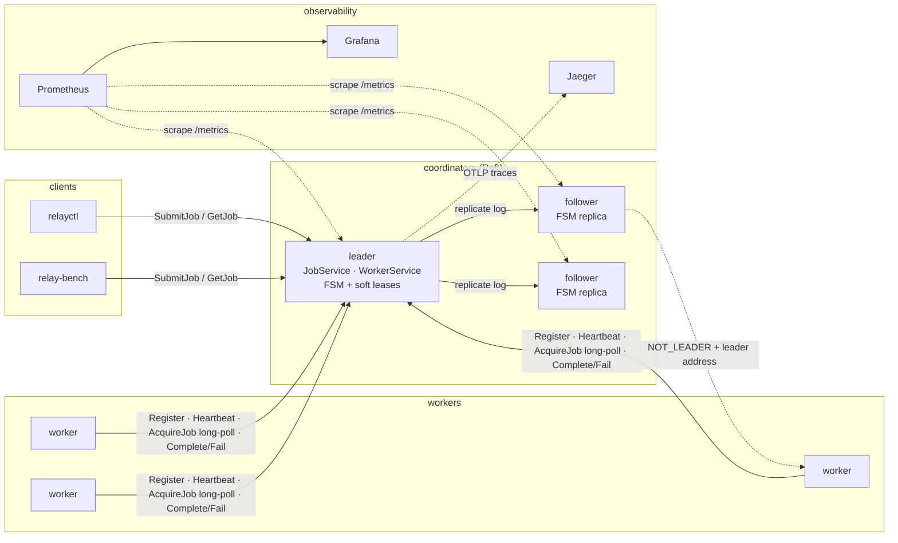
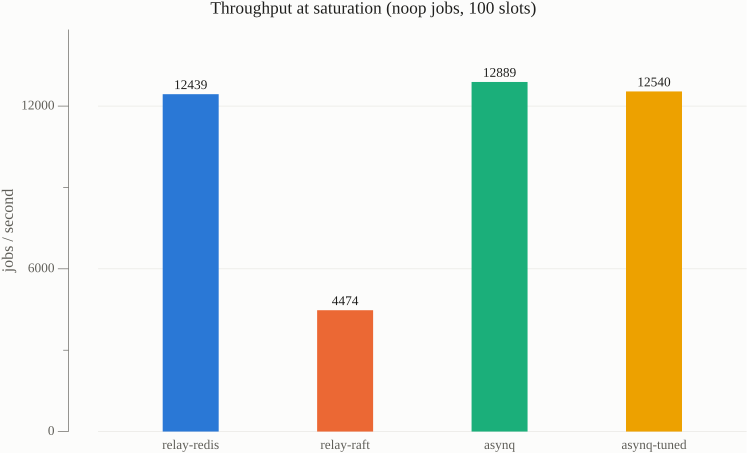
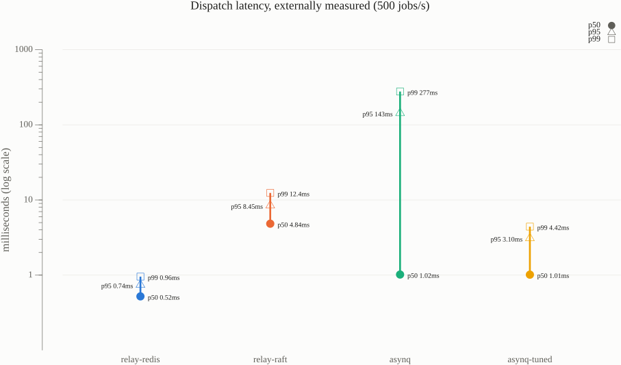
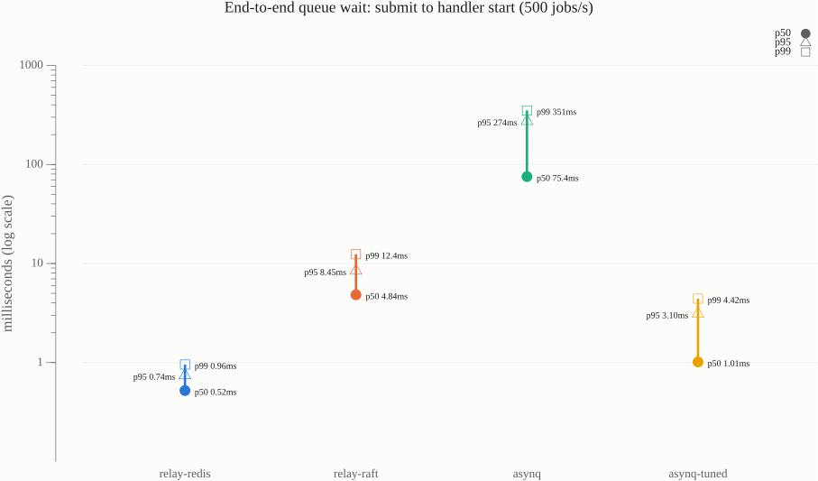
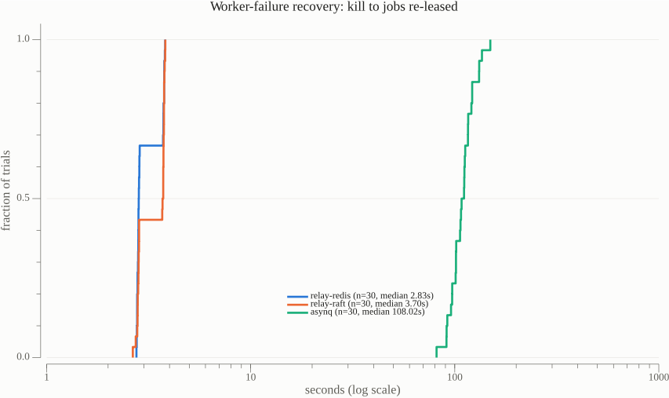
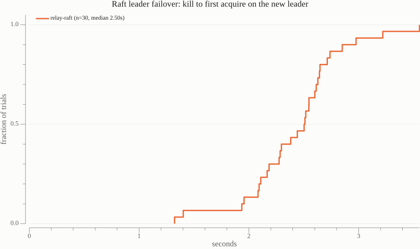

# Relay

Relay is a distributed task engine in Go. Clients submit jobs over gRPC, a
pool of workers long-polls for them, and the coordinators keep every job's
state transitions **exactly-once**, through worker crashes, stalls,
network partitions, and coordinator failover. State lives either in Redis
(one atomic Lua script per transition) or in a **Raft-replicated state
machine** spread across 3 or 5 coordinators, with no external dependency.

The claims are checked, not just asserted. A seeded chaos harness kills,
pauses and partitions real containers while recording Jepsen-style
histories. A checker then verifies every invariant plus per-job
linearizability (porcupine), and it is shown to catch a deliberately
injected fencing bug. The benchmarks compare Relay against
[asynq](https://github.com/hibiken/asynq) on the same workloads and
report the results as measured, including where Relay loses.

**[DESIGN.md](DESIGN.md)** is the full RFC: architecture, data model,
lease and fencing design, delivery semantics, the soft-state lease
argument for Raft, a failure-mode table, alternatives, limitations, and a
decision log.

- [30-second tour](#30-second-tour)
- [Architecture](#architecture)
- [Quickstart](#quickstart)
- [Correctness](#correctness)
- [Benchmarks](#benchmarks)
- [Observability](#observability)
- [Repository map](#repository-map)

## 30-second tour

- **Leases with fencing tokens.** A worker reports a result with
  `(worker_id, lease_token)`. The store applies it only if that token is
  still current, so a zombie worker's late result is rejected
  (`ABORTED`), never written. Tokens are a per-job counter on Redis and
  the Raft log index of the granting entry on Raft.
- **At-least-once execution, exactly-once transitions, idempotent
  submission.** These are stated precisely in
  [DESIGN §5](DESIGN.md#5-delivery-semantics).
- **Raft without heartbeat writes.** Lease deadlines and worker liveness
  are soft state on the leader. Only `ExpireLease(job, token)` is
  replicated, and a new leader grants everyone a full grace period. The
  argument for why that is safe is in
  [DESIGN §7](DESIGN.md#7-raft-integration-and-the-soft-state-lease-argument).
- **Leader-following clients.** Followers answer `NOT_LEADER` with the
  leader's address. Workers, `relayctl` and the benchmarks follow it, and
  they never blindly replay a call whose outcome is unknown.
- **Pluggable store.** One `Store` interface, two backends, and one
  conformance suite that both pass.

## Architecture



| Binary | Role |
|---|---|
| `coordinator` | gRPC server (`JobService`, `WorkerService`, `ClusterService`), long-poll dispatch, failure detector, lease reaper. `--store redis` or `--store raft` |
| `worker` | registers, heartbeats, runs `--concurrency` acquire→run→report loops (`noop`, `sleep`, `fail-n-times`), drains on SIGTERM |
| `relayctl` | `submit [--wait]`, `get`, `workers`, `health`, `cluster status\|add\|remove` |
| `relay-chaos` | seeded chaos runs plus the history checker |
| `relay-bench` | comparative benchmarks (`compare`) and charts (`plot`) |
| `asynq-worker` | the asynq baseline, with the same handlers and the same timing hooks |

## Quickstart

You need Go 1.26+ and a Docker-compatible runtime (Docker Desktop,
OrbStack, colima).

```sh
make up                     # 3 Raft coordinators + 3 workers + Jaeger, Prometheus, Grafana
go run ./cmd/relayctl --coordinator n1=localhost:50051,n2=localhost:50052,n3=localhost:50053 cluster status
go run ./cmd/relayctl --coordinator localhost:50051 submit --type fail-n-times --payload '{"n":1}' --max-attempts 3 --wait
open http://localhost:3000  # Grafana "Relay" dashboard; traces at http://localhost:16686
make down

make test                   # unit tests, Store conformance on both backends (-race)
make integration            # container failure tests, Raft failover and membership, chaos self-tests
make chaos SEED=1           # 5-minute seeded chaos run on Raft (BACKEND=redis for Redis)
make bench                  # Relay-Redis vs Relay-Raft vs asynq (~1.5h; see BENCH_ARGS in the Makefile)
```

`make up BACKEND=redis` runs the Redis backend instead. Every flag can
also be set through an environment variable: `RELAY_` plus the flag name
in upper case (`--lease-duration` → `RELAY_LEASE_DURATION`).

## Correctness

`relay-chaos run --seed N --duration 5m --faults all` brings up a cluster,
runs concurrent submitters with about 10% duplicate idempotency keys
against `sleep` and `fail-n-times` workers, and injects faults on a
schedule derived only from the seed:
- worker kill, pause and partition
- coordinator kill, pause, restart, client isolation and backend partition
- on Raft: leader kill, leader pause, leader partition (the old leader
  stays reachable by clients but is cut off from its peers), and
  full-cluster restart
- Toxiproxy latency and jitter between workers and coordinators

It heals everything, waits for quiescence, freezes the workers, and checks:

| Invariant | Checked against |
|---|---|
| no acknowledged submission lost | client acks vs final reads |
| every job terminal after quiescing | final state |
| at most one terminal transition; result written once | server event log, and accepted reports per lease token |
| every accepted report carried the current token | server log (latest LEASED) and real-time client order |
| duplicate keys map to one job | client acks and the stored key |
| attempts ≤ max; DEAD only at max | final state and event log |
| per-job linearizability | porcupine, with a nondeterministic model of transitions clients never see |

A failing run saves the history and a Porcupine visualization, and the
same seed reproduces the same fault schedule.

**Results.** On the Raft backend, **20 seeds × 5 minutes, every fault kind: 0
violations.** That is 158,273 jobs and 1,145,068 recorded operations
under 1,100 injected faults, including 59 leader
kills, 66 minority-side leader partitions and
52 full-cluster restarts. There were 379
leader elections, and 2,305 zombie reports were fenced out.
Per-seed numbers are in [DESIGN §9](DESIGN.md#9-verification) and
`bench/results/chaos-sweep-raft.json`. The Redis backend passes the same
harness (minus the leader faults; Redis itself is never faulted,
[DESIGN §8](DESIGN.md#8-failure-modes)).

**The checker catches real bugs.** Building with `-tags relay_nofence`
removes the token check from both backends. `make integration` runs that
build under worker pauses and partitions, and asserts the checker reports
fencing violations and non-linearizable jobs, with visualizations, while
every other invariant stays clean. Across the runs so far, each one flagged 12–19 fencing
violations and 9–10 non-linearizable jobs. Building the harness found
three real problems, all in the harness itself, each fixed at the root
and recorded in [DESIGN §12](DESIGN.md#12-decision-log):
- a final-snapshot race (fixed with a freeze hand-off)
- a backwards step of the VM's wall clock (histories now use
  `CLOCK_MONOTONIC`)
- a scheduler bug in overlapping fault windows

## Benchmarks

All numbers are from one run of `make bench`
([`bench/results/compare-20261026T085821Z.json`](bench/results/compare-20261026T085821Z.json),
charts alongside). The setup:
- **Hardware:** Apple M4 Pro (14 cores, 24 GB), macOS 26.6.2, go1.26.1.
- **Container runtime:** Docker Desktop 29.9.2, with
  14 CPUs and 7.7 GB for its VM.
- **Shared host:** every container (store, coordinators, workers, load
  driver) runs on that one machine, so there are no real network hops.
- **Configuration:** each backend's failure-detection settings are
  recorded in the results file.

| backend | throughput at saturation | dispatch latency p50 / p95 / p99 (ms) | end-to-end queue wait p50 / p95 / p99 (ms) | submit RTT p50 / p95 / p99 (ms) | worker-failure recovery p50 / p90 / max | leader failover p50 / p90 / max |
|---|---|---|---|---|---|---|
| **relay-redis** | 12,439 | 0.52 / 0.74 / 0.96 | 0.52 / 0.74 / 0.96 | 0.34 / 0.52 / 0.72 | 2.83s / 3.77s / 3.81s (n=30) | — |
| **relay-raft** | 4,474 | 4.84 / 8.45 / 12.41 | 4.84 / 8.45 / 12.41 | 3.06 / 5.67 / 8.44 | 3.70s / 3.78s / 3.81s (n=30) | 2.50s / 2.85s / 3.55s (n=30) |
| **asynq** | 12,889 | 1.02 / 143.32 / 277.02 | 75.43 / 273.59 / 350.91 | 0.20 / 0.43 / 0.73 | 108.02s / 131.59s / 149.36s (n=30) | — |
| **asynq-tuned** | 12,540 | 1.01 / 3.10 / 4.42 | 1.01 / 3.10 / 4.42 | 0.16 / 0.32 / 0.49 | — | — |







**Correctness under faults.** Each backend ran the same 2-minute
workload: 20 sleep jobs/s on 4 workers × 4 slots, while seeded faults
(seed 1) killed, paused or partitioned workers for 2–10s at a time. The
test then waited for every acknowledged job to finish.

| backend | faults | acked jobs | lost | unfinished | duplicate executions | duplicate terminal transitions |
|---|---|---|---|---|---|---|
| relay-redis | 18 | 2,460 | 0 | 0 | 45 | 0 |
| relay-raft | 18 | 2,464 | 0 | 0 | 45 | 0 |
| asynq | 18 | 2,460 | 0 | 0 | 8 | not observable |

### Workloads and definitions

- **Workers.** Every backend gets the same worker containers (10 × 10
  slots), the same handlers (`noop` and `sleep`) and the same Redis
  configuration (AOF, `everysec`). asynq runs with its default
  configuration (**asynq**) and with `TaskCheckInterval=10ms`
  (**asynq-tuned**), so its default polling interval is not the only
  thing on show. asynq is driven through its own client, server, mux,
  `TaskID` and `MaxRetry` APIs.
- **Throughput at saturation.** 20,000 `noop` jobs are preloaded with no
  workers running, then all 10 workers start. Throughput is jobs ÷ (last
  handler end − first handler start). This measures scheduling cost per
  job, because there is no work in the jobs.
- **Dispatch latency, one definition for every backend.** This is the
  project's existing definition, "assignment time minus max(job eligible
  time, worker request time)", observed from outside so asynq can be
  measured too:
  - *assignment* is the handler start;
  - *eligible* is when the driver invoked the submit;
  - *worker request* is when a slot on that worker became free, simulated
    FIFO from that worker's handler start/end events.

  Every timestamp comes from `CLOCK_MONOTONIC` inside the one Docker VM.
  The load is 30,000 `sleep(20ms)` jobs at a steady 500/s, about 10% of
  capacity.
- **End-to-end queue wait.** Handler start minus submit invoked.
- **Worker-failure recovery.** Trials use 4 workers × 2 slots, 4 jobs of
  8s each, so there is spare capacity. In each trial a worker holding at
  least one job is killed with `docker kill`. Recovery runs from the
  container's death time (Docker's own clock) to the last of its jobs
  starting on another worker (the worker's wall clock, the same VM).
  There are 30 trials per backend.
- **Leader failover** (Raft only). Under a steady trickle of 50 jobs/s,
  the leader is killed with `docker kill`. Failover runs to the first
  `AcquireJob` that was *sent after the kill* and returned a job, which
  only a new leader can grant. The node is restarted and the cluster
  rejoins between trials. There are 30 trials.

### What the numbers say, including where Relay loses

- **Throughput: asynq wins, narrowly against Relay-Redis and clearly
  against Relay-Raft.** asynq dequeues straight from Redis inside its
  worker process. Relay adds a gRPC hop through the coordinator per
  acquire and per report, and still lands within 4%
  (12,439 vs 12,889 jobs/s).
  **Relay-Raft is about 3× slower**
  (4,474 jobs/s). Every
  acquire and every completion is a Raft log entry, replicated to a
  majority and fsynced by bbolt before it is applied. That is the price
  of having no single point of failure, and it is the main
  [known limitation](DESIGN.md#11-known-limitations) of the replicated
  design.
- **Dispatch latency: Relay-Redis is fastest; asynq's default is
  dominated by its poll interval.** With an empty queue, an asynq server
  sleeps for `TaskCheckInterval` (1s by default) between dequeue
  attempts, so jobs pile up during a sleep and then drain in a burst.
  Jobs that waited through a sleep, while slots sat idle, show up in the
  p95/p99 (143 / 277 ms). Jobs drained in the burst waited only for
  slots, which the definition excludes, which is why the p50 is 1 ms. The
  end-to-end queue wait (p50 75 ms) shows the full cost. With a 10 ms
  interval, asynq-tuned is close to Relay-Redis: 1.01 vs 0.52 ms p50,
  and 4.4 vs 0.96 ms p99. Relay's long-poll plus FIFO notifier hands a
  job to an already-waiting worker without polling. Relay-Raft's ~5 ms
  p50 is the log commit on submit and on acquire (see submit RTT: 3 ms).
- **Recovery from a dead worker: Relay is about 30–40× faster.** Relay
  declares a worker dead after 3 missed 1s heartbeats and requeues its
  jobs in the same atomic step. That takes 2.8–3.8s; the two modes come
  from the detector's 1s tick. asynq waits for its fixed 30s lease to
  expire, then *another* 30s (its clock-skew allowance), then for its
  recoverer, which runs every 60s. The reclaimed task then waits a
  sidekiq-style retry delay of 15–44s. That gives the measured
  81–149s.
- **Leader failover (Relay-Raft): 2.5s median, 3.6s worst.** That is
  Raft's 1s heartbeat timeout plus a randomized election, the new
  leader's `Barrier`, and clients following `NOT_LEADER` to it. Raft's
  timeouts can be lowered at the cost of spurious elections on a loaded
  host.
- **Faults: no backend lost a job, and Relay records zero duplicate
  terminal transitions.**
  - Relay re-ran more jobs (45 vs 8). Detecting failure in 3s means a
    worker paused or partitioned for 2–10s gets its jobs reassigned while
    it is still running them. That trade, faster recovery for more
    duplicate executions, is inherent to at-least-once execution, and
    fencing is what keeps it from becoming a duplicate *completion*.
  - asynq waits out short pauses because of its 30s lease. For the
    duplicates it does have, it records no transition history, so
    whether a zombie's completion was also accepted cannot be checked.
    Its worker checks its lease against its *own* clock before writing,
    and Redis checks no token
    ([DESIGN §10](DESIGN.md#10-alternatives-considered)).

**A note on Relay's internal metric.** The coordinator's own dispatch
latency, the project's original metric
([details](#relays-coordinator-measured-latency)), reports Relay-Redis at
p50 0.15 / p95 1.16 / p99 1.23 ms.
That is lower at the median than the external number, because it starts
when the job is eligible inside Redis rather than at submit, but *higher*
at p95. Its `redis_now − eligible_at` term uses Redis `TIME` truncated to
whole milliseconds, so a 0.1 ms wait can count as 1 ms. The internal
queue wait shows the quantization directly: p50 0.00 ms,
p95 1.00 ms. The definition is unchanged; this is a
resolution limit, documented in
[DESIGN §11](DESIGN.md#11-known-limitations). On Raft the internal metric
is p50 4.11 / p99 11.24 ms.

### Relay's coordinator-measured latency

`make bench-relay` runs the original single-backend benchmark (burst,
steady and preload modes against Relay-Redis, with latency measured by
the coordinator). Its last result is
[`bench/results/20261026T053700Z.json`](bench/results/20261026T053700Z.json):
p95 scheduling latency of 1.69 ms in burst mode, 0.18 ms in steady mode
and 1.27 ms in preload mode, against a target of 25 ms.

## Observability

- **Tracing.** Each job is one trace:
  `SubmitJob → relay.enqueue → relay.dispatch → relay.execute (worker) → CompleteJob`.
  Each retry shows up as its own dispatch/execute branch. The submit's W3C
  traceparent is stored with the job to bridge the queue, and otelgrpc
  carries context across the RPCs.
- **Prometheus at `/metrics`.** It exposes dispatch latency, queue wait,
  queue depth, active leases, lease expirations, reassignments,
  stale-completion rejections, Raft commit latency, leader changes and
  leadership.
- **Grafana.** The "Relay" dashboard in `deploy/grafana` is provisioned
  automatically by `make up`.

## Repository map

| Path | |
|---|---|
| `internal/store` | `Store` interface; `redis/` (Lua), `raft/` (FSM, soft leases, membership), `storetest/` (conformance) |
| `internal/coordinator` | gRPC services, long-poll notifier, liveness loops, leadership handling |
| `internal/rpc` | `DialCluster`: NOT_LEADER-following client |
| `internal/history`, `internal/check` | Jepsen-style history recording and the checker |
| `cmd/relay-chaos` | chaos orchestrator, workload, and fault schedule |
| `cmd/relay-bench` | benchmarks (`compare`, `drive`, `plot`) |
| `deploy/` | compose files (Redis, Raft, chaos, bench, observability), Grafana and Prometheus config |
| `bench/results/` | committed results JSON and charts |
